# Praktikum 9 – PHP Modular

Praktikum ini membahas penerapan modularisasi pada PHP dengan memisahkan program menjadi beberapa file berdasarkan fungsi dan kegunaannya. Tujuannya agar kode lebih terstruktur, mudah digunakan kembali, dan mudah dikembangkan.

## 1. Persiapan

Menyiapkan folder project `lab9_php_modular` di dalam folder `htdocs`. Praktikum menggunakan XAMPP sebagai web server lokal dan Visual Studio Code sebagai editor kode.

## 2. Pengujian Include dan Require

Membuat file `pesan.php`, `uji-include.php`, dan `uji-require.php` untuk memahami cara memanggil file PHP lain. Pengujian dilakukan untuk melihat perbedaan `include` dan `require` ketika file yang dipanggil tersedia maupun tidak ditemukan.

## 3. Membuat Template

Membuat file `header.php` dan `footer.php` sebagai bagian tampilan yang digunakan bersama. Dengan template, bagian judul, navigasi, dan footer tidak perlu ditulis ulang pada setiap halaman.

## 4. Membuat Function PHP

Membuat function dengan parameter dan nilai kembalian (`return`). Function yang dibuat meliputi:
- `konversiCelciusKeFahrenheit()` untuk mengubah suhu Celsius ke Fahrenheit.
- `tentukanStatusNilai()` untuk menentukan predikat nilai.
- `hitungTotal()` untuk menghitung total belanja.

## 5. Membuat Helper Functions

Memindahkan function ke file `helpers.php` agar dapat digunakan kembali pada beberapa halaman. Function tambahan yang dibuat meliputi `formatRupiah()`, `hitungDiskon()`, `validasiEmail()`, dan `ringkasTeks()`.

## 6. Menata Struktur Direktori

Mengelompokkan file aplikasi ke dalam folder sesuai kegunaannya, seperti `config` untuk konfigurasi database, `views` untuk tampilan, `helpers` untuk function, `modules` untuk fitur aplikasi, dan `assets` untuk file pendukung.

## 7. Membuat Routing

Membuat sistem routing melalui file `index.php` dengan menggunakan parameter URL `page`. Routing digunakan untuk mengatur halaman yang akan ditampilkan, seperti Dashboard, Data Barang, Tambah Barang, Ubah Barang, dan Hapus Barang. Halaman yang tidak terdaftar akan menampilkan halaman 404.

## 8. Menghubungkan Database

Memindahkan konfigurasi koneksi database ke dalam file `config/database.php`. Koneksi menggunakan MySQLi dan database `latihan1` yang telah digunakan pada praktikum sebelumnya.

## 9. Mengintegrasikan CRUD

Mengintegrasikan fitur pengelolaan data barang ke dalam struktur modular, meliputi:
- **Create:** Menambahkan data barang baru beserta gambar.
- **Read:** Menampilkan data barang dari database.
- **Update:** Mengubah informasi barang yang telah tersimpan.
- **Delete:** Menghapus data barang berdasarkan ID.

## 10. Pengujian Aplikasi

Melakukan pengujian terhadap halaman Dashboard, Data Barang, routing, halaman 404, serta seluruh fitur CRUD untuk memastikan aplikasi berjalan sesuai fungsinya.

## Kesimpulan

Praktikum PHP Modular memberikan pemahaman mengenai pemisahan program ke dalam beberapa file berdasarkan tanggung jawabnya. Dengan menggunakan template, helper functions, struktur direktori, dan routing, aplikasi menjadi lebih terorganisir. Selain itu, fitur CRUD dari praktikum sebelumnya tetap dapat digunakan dalam struktur aplikasi modular.

## Lampiran

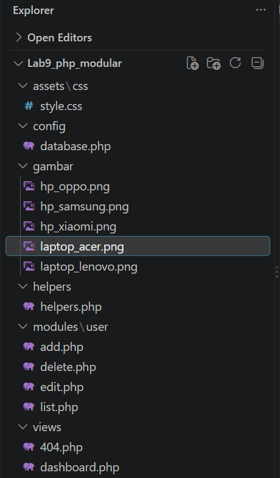
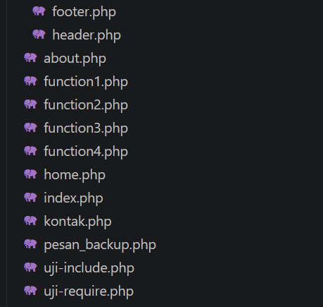
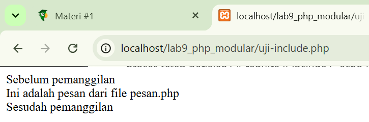
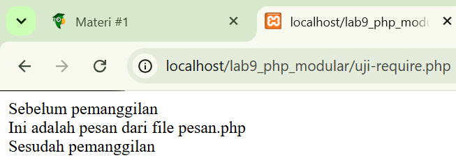
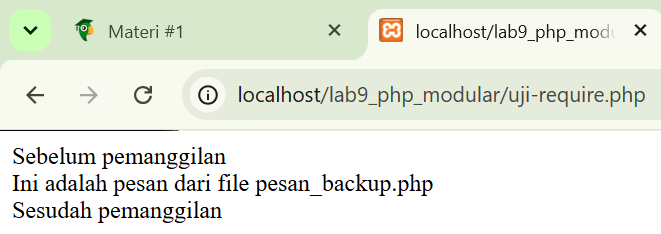
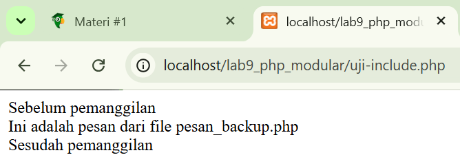
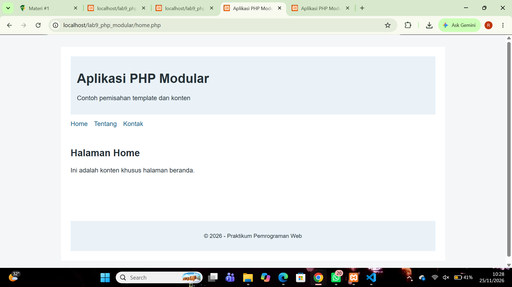
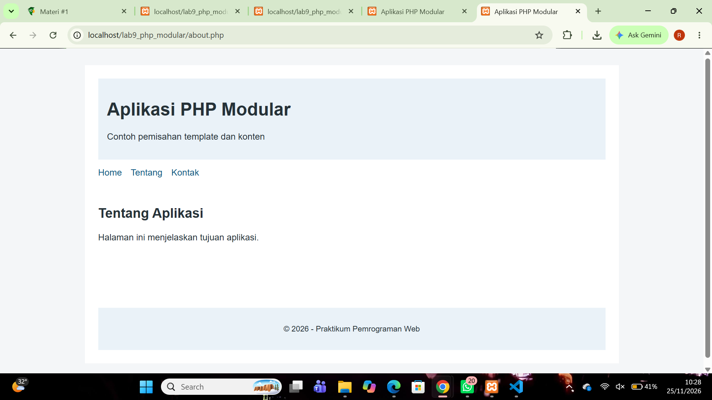
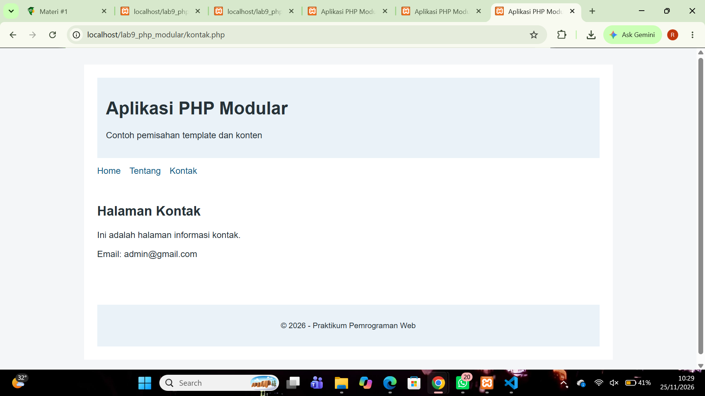
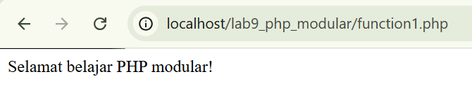
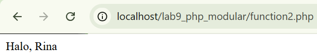
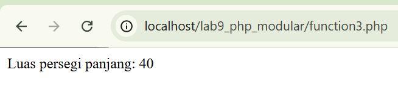
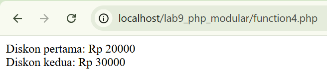
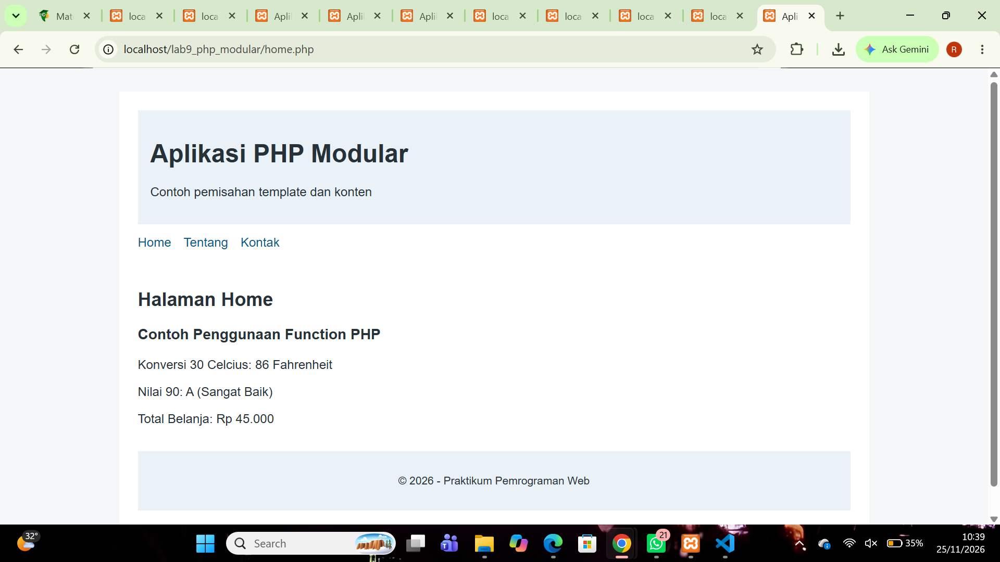
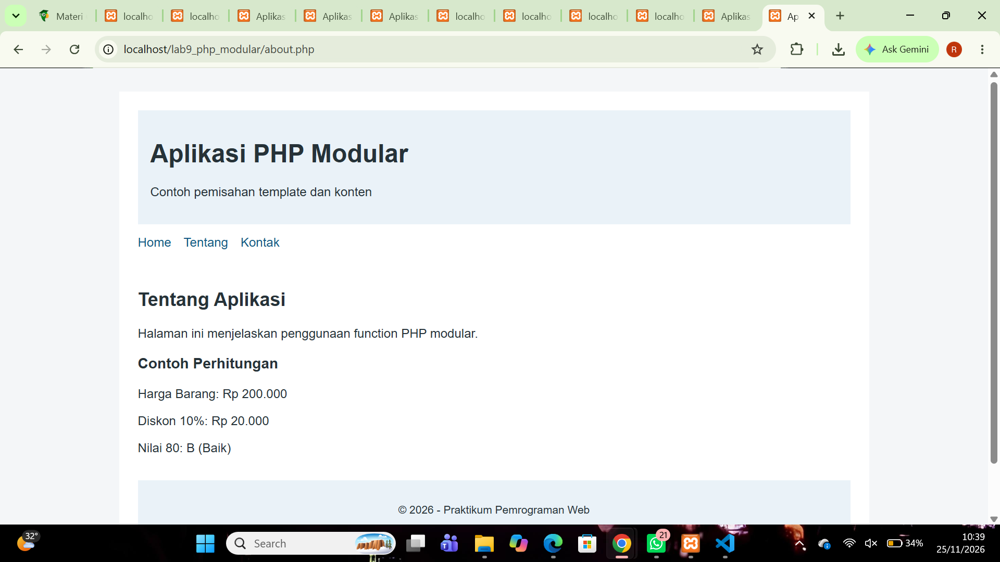
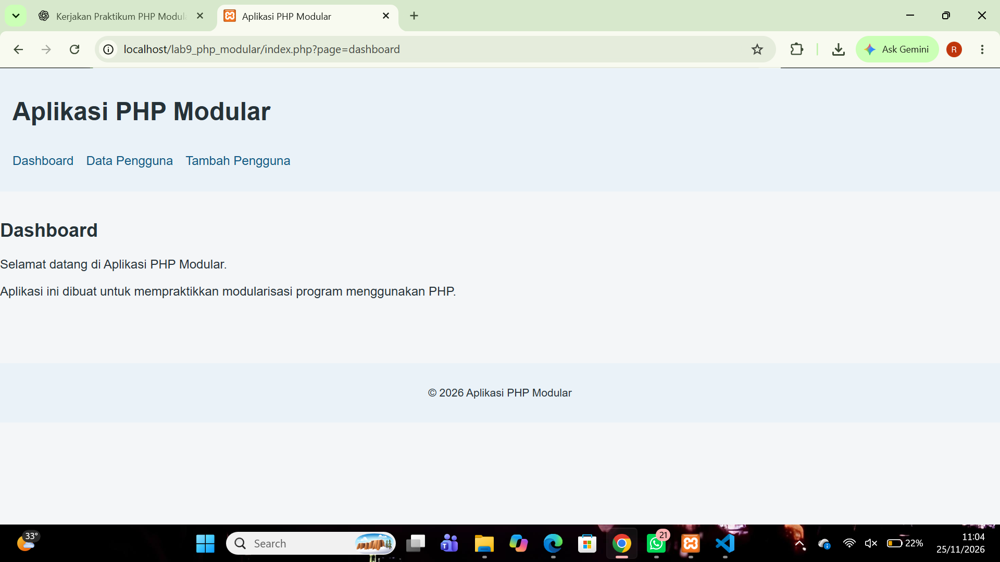
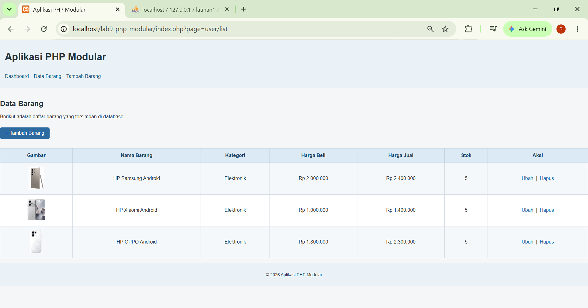
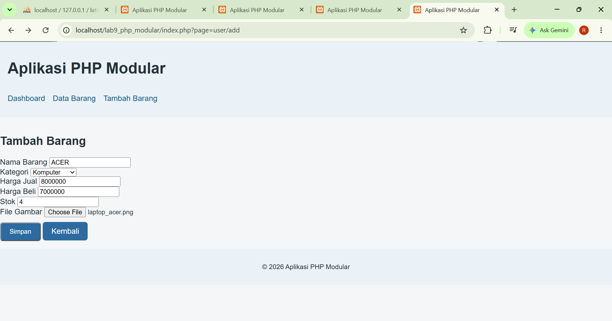
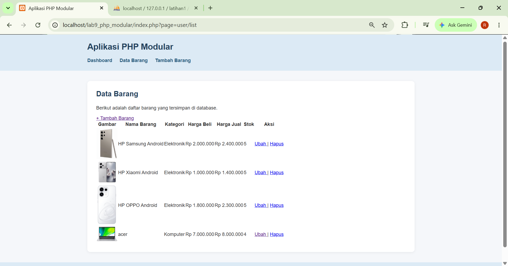
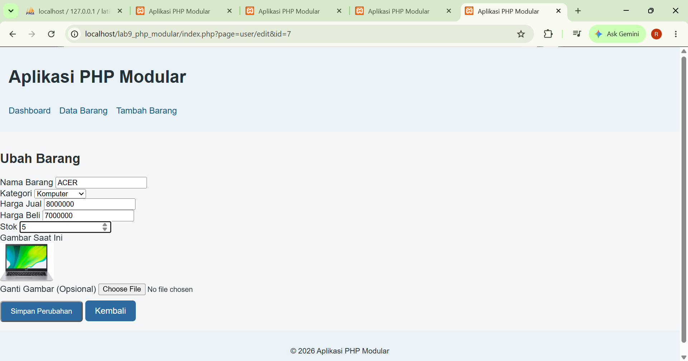
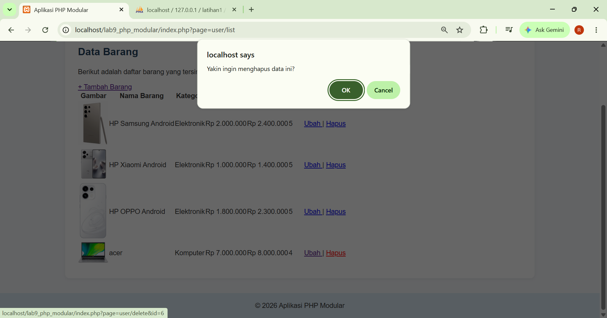
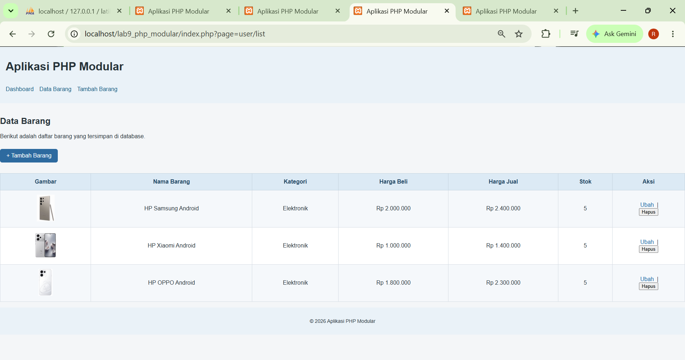
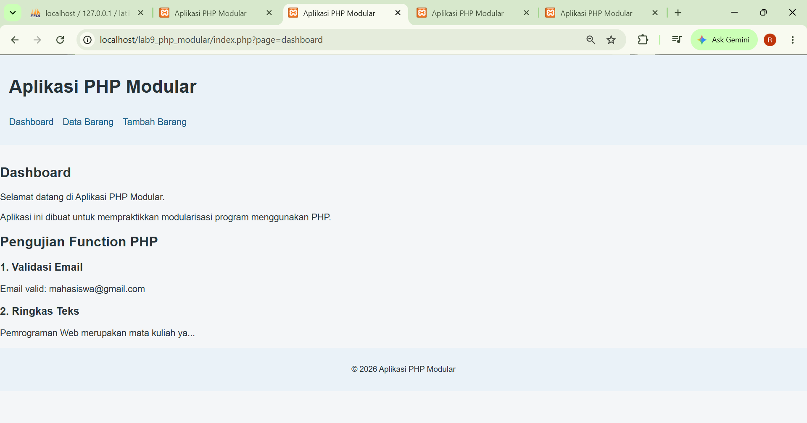
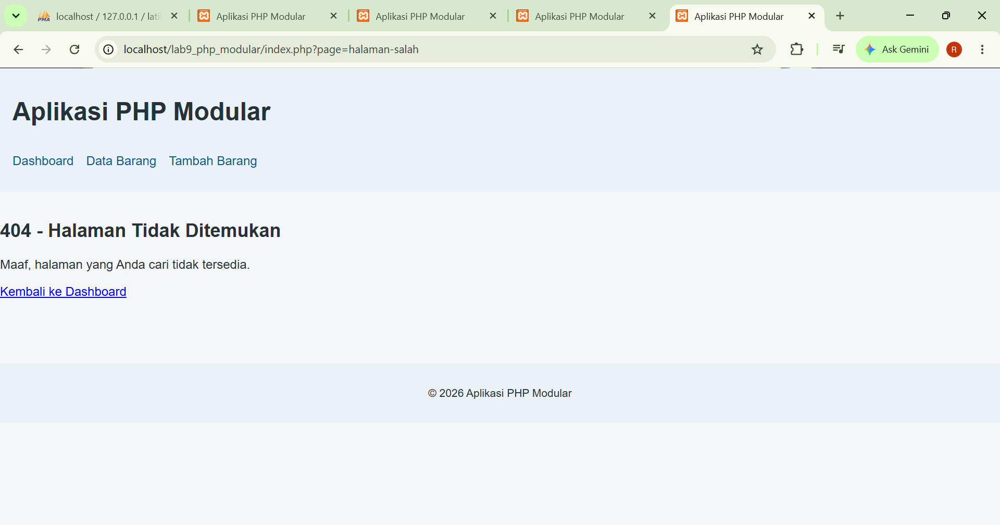